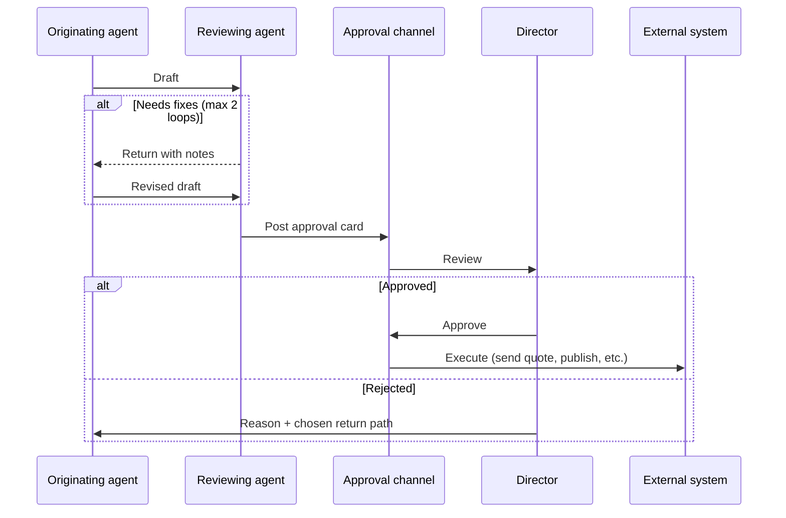

# Multi-Agent Operating Model

How specialized AI agents divide work, hand it off, and stay under human supervision. The pattern is deliberately general; agent names, prompts, and vendor IDs from the live system are not published.

## Roles

| Agent role | Responsibility | Can act externally? |
|---|---|---|
| **Orchestrator** | Routes work between agents, checks output before it reaches the director, produces a daily briefing | No |
| **Intake** | Qualifies inbound inquiries and writes them to the CRM ([reference workflow](../workflows/client-intake-agent/)) | Writes to CRM only |
| **Proposal & SOW** | Drafts proposals and quotes from CRM deal data | Only after approval |
| **GRC Assessment** | Runs NIST AI RMF / FAIR assessments on proposed and delivered automations | No |
| **Delivery Tracker** | Tracks project milestones and flags slippage | No |
| **Content** | Drafts thought-leadership and campaign content | Only after approval |
| **Workflow Audit** | Reviews deployed automations for reliability and performance; findings go to GRC | No |

## Handoff and approval flow

## Design choices

- **The CRM is the single system of record.** Agents read and write a defined set of custom properties, all under one naming prefix, so every AI-written field is identifiable.
- **Coordination happens in a team chat channel** through approval cards, so the director sees and controls handoffs in a tool already in daily use.
- **Workflows run on one self-managed engine.** A low-code SaaS platform is used for prototyping only and is never in the production path.
- **Every agent is reachable directly by the director** for intervention, not only through the orchestrator.

See [ADR-004](../decisions/004-human-approval-gates-for-agents.md) for the rules that govern which actions need approval.
