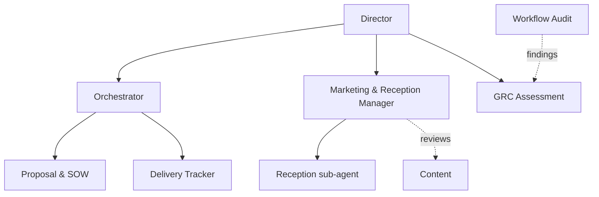
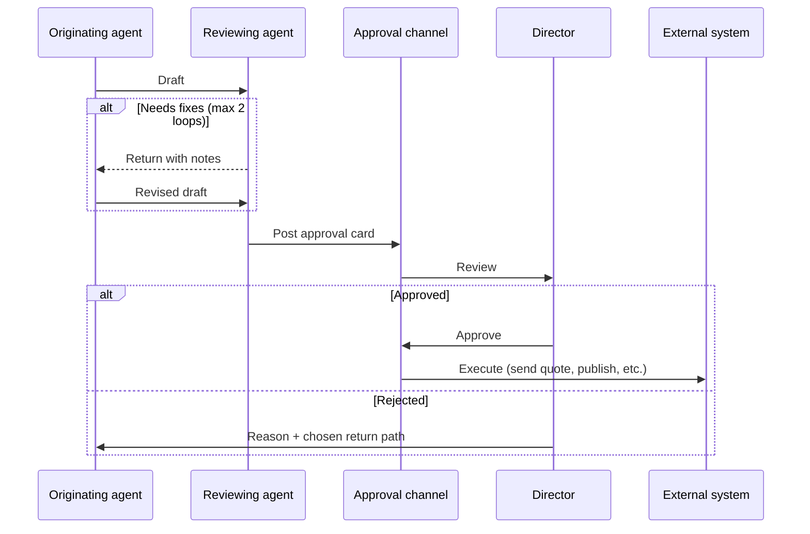

# Multi-Agent Operating Model

How specialized AI agents divide work, hand it off, and stay under human supervision. The pattern is deliberately general: agent names, personas, prompts, and vendor IDs from the live system are not published.

For what is live versus still being built, see [build-status.md](build-status.md).

## Roles and reporting lines

Each agent has one job, one manager, and a defined limit on what it may do outside the system.

| Agent role | Responsibility | Reports to | Can act externally? |
|---|---|---|---|
| **Orchestrator** | Researches leads and solution options, routes work to the right agent, checks output before it reaches the director, produces a daily briefing | Director | No |
| **Marketing & Reception Manager** | Owns the client funnel and all booking coordination; reviews content and proposals for fit, tone, and funnel opportunities | Director | Confirms bookings only |
| **Reception (sub-agent)** | First contact on phone and website chat; qualifies new inquiries ([reference workflow](../workflows/client-intake-agent/)) | Marketing & Reception Manager | Writes inbound leads to the CRM |
| **Proposal & SOW** | Drafts proposals and statements of work | Orchestrator | Only after approval |
| **GRC Assessment** | Runs NIST AI RMF / FAIR assessments on proposed and delivered automations | Director | No |
| **Delivery Tracker** | Tracks milestones, builds realistic timelines from the director's real availability, flags slippage | Orchestrator | No |
| **Content** | Drafts thought-leadership and campaign content | Marketing & Reception Manager (review) | Only after approval |
| **Workflow Audit** | Reviews deployed automations for reliability and performance | GRC Assessment (findings) | No |

**Delegation rule:** an agent that cannot complete a task hands it to the agent that owns that capability rather than improvising. For example, anything involving calendar availability goes to the Delivery Tracker.

## Handoff and approval flow

## The proposal chain

Proposals are assembled by several agents in sequence, and the director steps in once, at the end.

1. **Trigger:** after intake, if the lead wants a meeting and gave enough detail, the lead is submitted as a needs assessment. Otherwise the chain starts after the strategy session.
2. **Research:** the Orchestrator studies the lead's business and industry and identifies solution options.
3. **Timeline:** the Delivery Tracker builds a realistic schedule from the director's actual calendar and the client's goals.
4. **Orchestration plan:** the Orchestrator decides which agents and workflows would deliver each part.
5. **Draft:** the Proposal agent writes the proposal.
6. **Review:** the Marketing & Reception Manager checks fit with the client's goals, pricing tier, tone, and follow-on opportunities. GRC Assessment checks risk and compliance.
7. **Director approval**, then the quote and payment link go to the client through the payment processor's customer portal ([ADR-005](../decisions/005-quotes-and-payments-via-payment-processor.md)).

## Scheduling

Every booking request, whether from website chat, a phone call, an existing client, or outbound prospecting, goes to one coordinator: the Marketing & Reception Manager.

1. The Reception sub-agent collects the request and passes it on. It does not book directly.
2. The coordinator gets available slots from the agent that holds the availability model. Rules differ by calendar type: a class or a client meeting is fixed, while some work blocks are flexible.
3. Conflicts get a proposed resolution, and anything ambiguous goes to the director before it is finalized.
4. The coordinator confirms with the client and is the only agent that notifies the director of a new booking.

A single coordinator means no double-bookings from two agents acting on stale availability, and one place to audit every booking.

## Channels

| Channel | Who uses it | Purpose |
|---|---|---|
| Phone voice agent | Prospects and clients | Inbound intake and appointment help |
| Website avatar chat | Prospects | Inbound intake from the public site ([ADR-006](../decisions/006-website-intake-through-one-pipeline.md)) |
| Team chat | Agents and director | Agent-to-agent handoffs, approval cards, status threads |
| Direct voice/chat | Director | Reach any agent directly to interject or redirect |
| Live operations dashboard | Director | Watch agents work in real time ([ADR-007](../decisions/007-agent-identity-and-observability.md)) |

## Design choices

- **The CRM is the single system of record for leads and deals.** Agents read and write a defined set of custom properties under one naming prefix, so every AI-written field is identifiable.
- **Every channel feeds the same intake pipeline.** A lead from the website gets the same validation, scoring, and review as one from the phone.
- **Each agent has its own identity in team chat,** and one dedicated bot handles approval cards, so every message and approval is attributable.
- **Every agent step emits an event** to a live dashboard: an org chart, in-flight runs, an activity feed, and a "waiting on you" strip.
- **Workflows run on one self-managed engine.** A low-code SaaS platform is used for prototyping only and is never in the production path.
- **Every agent is reachable directly by the director,** not only through the Orchestrator.

See [ADR-004](../decisions/004-human-approval-gates-for-agents.md) for the rules that govern which actions need approval.
