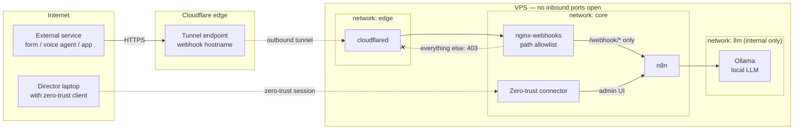

# Architecture Overview

This is the reference pattern for a self-managed AI automation stack: an n8n workflow engine with a local LLM, running in Docker on a single Linux VPS, with **no inbound ports open to the internet.**

## The problem this solves

Automation platforms need two kinds of access that pull in opposite directions:

- **Webhooks** must be reachable by outside services (a web form, a voice agent, a payment processor).
- **The admin interface**, where workflows and stored credentials live, must be reachable by almost no one.

The common shortcut is to publish the n8n port and put a password on it. That exposes the most sensitive part of the system to every scanner on the internet. This design separates the two paths completely.

## Traffic flow

## Why each piece is there

| Component | Role | Key control |
|---|---|---|
| **Cloudflare Tunnel (`cloudflared`)** | Carries public webhook traffic into the VPS | Outbound-only connection. The VPS never listens on a public port. |
| **nginx-webhooks** | Reverse proxy between the tunnel and n8n | Allowlists `/webhook/` and `/webhook-test/`. Every other path returns 403, so the admin UI is unreachable through the tunnel even if someone guesses the hostname. |
| **n8n** | Workflow engine | No published ports. Stored credentials are encrypted with a key held outside the repo. |
| **Ollama** | Local LLM for tasks where data should not leave the server | On an `internal` Docker network with no route to the internet and no route from the edge. |
| **Zero-trust connector** | Admin access to n8n | Identity-based access per user and device. Replaces VPN or open admin ports. |

## Network segmentation

Three Docker networks limit what each container can reach:

- **`edge`**: `cloudflared` and `nginx-webhooks` only. The tunnel can reach the proxy and nothing else.
- **`core`**: `nginx-webhooks`, `n8n`, and the zero-trust connector. Has outbound internet for API calls.
- **`llm`**: `n8n` and `Ollama`, marked `internal: true`. The model server has no internet route and cannot be reached from the edge.

If `cloudflared` were compromised, it still could not talk to n8n directly. It would have to go through nginx's allowlist.

## What is deliberately *not* in this diagram

Real hostnames, IP addresses, tunnel names, account IDs, and the zero-trust network name. Those belong in a private repository, never a public one.

See [`../reference-stack/`](../reference-stack/) for the Compose template that implements this, and [`../decisions/`](../decisions/) for the reasoning behind each choice.
