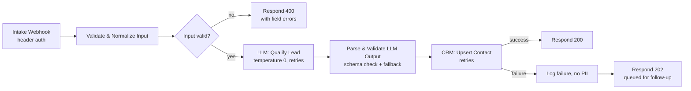

# Client Intake Agent

An n8n workflow that receives an inbound inquiry (from a web form or voice agent), qualifies it with an LLM, and writes the result to a CRM. It is the first agent in a multi-agent consulting operations system, and it is built to fail safely.

## Flow



## Controls built into each step

| Step | Control | Why |
|---|---|---|
| Webhook | Header-token authentication | Only known senders can trigger the workflow |
| Validate & Normalize | Required fields, email format, length caps, null-safe access | Malformed input never reaches the LLM or the CRM |
| Validate & Normalize | Strips `<` and `>` from free text | The message is wrapped in `<inquiry>` tags; this stops it from closing the tag early |
| LLM: Qualify Lead | System/user role separation; system prompt says tag contents are data, not instructions | Reduces prompt-injection risk from the inquiry text |
| LLM: Qualify Lead | `temperature: 0`, JSON-only output contract | Deterministic, machine-parseable results |
| LLM: Qualify Lead | 3 retries with backoff; continues on error | A provider outage does not lose the lead |
| Parse & Validate | Output checked against [`schemas/llm-qualification.schema.json`](schemas/llm-qualification.schema.json); anything off-schema falls back to a safe default | LLM output is untrusted input |
| Parse & Validate | Low scores and Enterprise-tier leads are flagged for human review | People make the consequential calls |
| CRM: Upsert | Upsert by email | Repeat inquiries update one record instead of creating duplicates |
| CRM failure path | Logs the error message only, never the lead's personal data | Keeps PII out of execution logs |
| Workflow settings | Successful execution data not retained; errors retained | Data minimization with enough evidence to debug |

## Files

```
workflow.json                       n8n export (import via Workflows → Import from file)
schemas/intake-request.schema.json  What the webhook accepts
schemas/llm-qualification.schema.json  What the LLM must return
samples/                            Example request, bad request, and expected LLM output
tests/code-nodes.test.js            Runs the validation and parsing logic outside n8n
```

## Running the tests

```bash
node workflows/client-intake-agent/tests/code-nodes.test.js
```

The tests confirm that valid input passes, empty and malformed input is rejected without crashing, and malformed, off-schema, or missing LLM output always routes to human review.

## Using this workflow

1. Import `workflow.json` into n8n.
2. Create three Header Auth credentials (webhook token, LLM API key, CRM token) and select them on the matching nodes. Every credential in the export is a `REPLACE_ME` placeholder.
3. Replace `claude-model-id-here` with your model ID.
4. Create the four custom CRM properties (`org_ai_intake_summary`, `org_ai_recommended_tier`, `org_ai_qualification_score`, `org_ai_needs_review`) or rename them to match your CRM's convention.
5. Run the samples through the test webhook before activating.

## Governance

This workflow's NIST AI RMF mapping and FAIR risk analysis are in [`../../governance/`](../../governance/).
